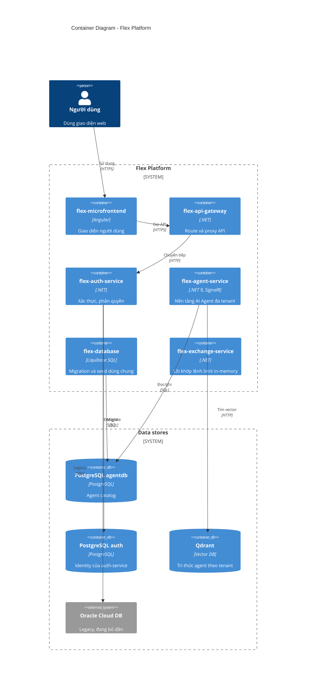

# C4 Container - Flex Platform

Nguồn: `workstation.json` và `docs/architecture/system-map.md` (mục 4, 5, 6, 7). Chỉ vẽ cạnh đã có bằng chứng trong tài liệu; chưa đối chiếu với code từng repo.

## Ghi chú

| Cạnh / thành phần | Trạng thái | Bằng chứng |
| --- | --- | --- |
| frontend → gateway → auth | `Inferred` | `system-map.md` mục 6 (sơ đồ cũ) |
| auth → PostgreSQL | `Confirmed`, đang migrate | `specs/000009-auth-postgres-migration` |
| auth → Oracle | `Confirmed by user`, sẽ bỏ | `system-map.md` mục 5 |
| agent → agentdb, Qdrant | `Confirmed` | `specs/000008-agent-platform-mvp`, mục 5 |
| dbmigrate → agentdb | `Confirmed by user` | `flex-database/agentdb/` |
| `flex-exchange-service` | Chạy độc lập, chưa có cạnh | `system-map.md` mục 4 |

## Chưa vẽ (cần xác minh)

- `flex-k8s`: mới khởi tạo, chưa có workload.
- `flex-environment`: stack local/dev (Redis, RabbitMQ, MinIO, Elasticsearch, Kibana, Jenkins, Portainer, Ollama). Nên vẽ ở `c4-deployment.md`.
- MySQL database-per-tenant và PostgreSQL `flexdb`: chưa rõ service nào truy cập.
- Giao thức `gateway → auth`, `agent → qdrant` đang ghi theo giả định, cần đối chiếu code.
