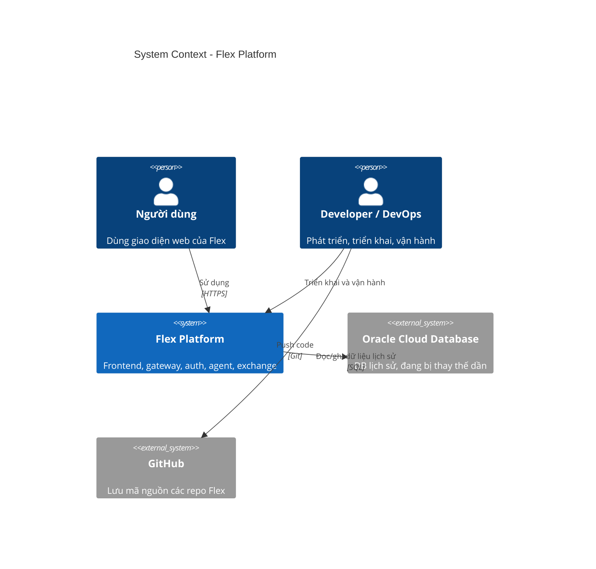

# C4 Context - Flex Platform

Nguồn: `workstation.json` và `docs/architecture/system-map.md` (mục 4, 5). Chưa đối chiếu với code từng repo.

## Ghi chú

| Cạnh | Trạng thái | Bằng chứng |
| --- | --- | --- |
| Flex Platform → Oracle | `Confirmed by user`, đang bỏ dần | `system-map.md` mục 5 |
| Developer → GitHub | `Confirmed` | `workstation.json` (url các repo) |
| Người dùng → Flex Platform | `Inferred` | Có `flex-microfrontend` |
