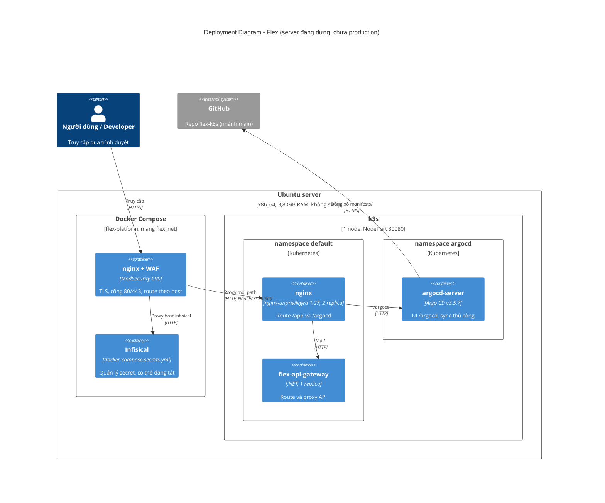

# C4 Deployment - Flex (server đang dựng)

Nguồn: `flex-environment/AGENTS.md`, `flex-environment/docker-compose.{nginx,tools,secrets}.yml`, `flex-k8s/README.md`, `flex-k8s/manifests/`, `flex-k8s/argocd/`. Chỉ đọc cấu hình trong repo, chưa kiểm tra server thật (`kubectl`, `docker ps`), nên đây là topology khai báo, chưa phải trạng thái chạy.

## Ghi chú

| Thành phần | Trạng thái | Bằng chứng |
| --- | --- | --- |
| nginx Docker (WAF) → NodePort `30080` | `Confirmed` (khai báo) | `flex-k8s/README.md` mục "Cài Argo CD", `flex-environment/AGENTS.md` mục 3, 4 |
| nginx k8s: 2 replica, `/api/` → gateway, `/argocd` → Argo CD | `Confirmed` (khai báo) | `manifests/nginx/{deployment,configmap}.yaml` |
| `flex-api-gateway`: 1 replica, image `1.0.1-dev`, chỉ nginx được vào cổng 8080 | `Confirmed` (khai báo) | `manifests/flex-api-gateway/{deployment,networkpolicy}.yaml` |
| Argo CD v3.5.7, non-HA, application `flex` sync thủ công | `Confirmed` (khai báo) | `argocd/install/`, `argocd/application.yaml` |
| Infisical | `Cần làm rõ` | Có file riêng và host `infisical.luyenhaidangit.pro`, nhưng `restart.sh` ghi tạm tắt để giải phóng RAM |
| Portainer, netshoot | Không vẽ cạnh | Portainer chỉ nghe `127.0.0.1:9000` trên server (SSH tunnel), có host riêng ở site prod |

## Chưa vẽ / cần xác minh

- **Trạng thái chạy thật**: README `flex-k8s` còn ghi "chưa apply lên cluster nào" nhưng cũng mô tả Argo CD đang truy cập qua `flex.luyenhaidangit.pro/argocd`. Cần `kubectl get pods -A` và `docker ps` trên server để chốt.
- **`flex-auth-service` chưa có trong cluster**: README `flex-k8s` ghi route `/api/*` trả 502/503 cho tới khi triển khai.
- **Frontend**: chưa thấy workload frontend trong `flex-k8s`; nginx k8s chỉ route `/api/` và `/argocd`. Chưa rõ frontend chạy ở đâu.
- **Cảnh báo bảo mật còn mở** (theo README): NodePort `30080` cần firewall host chặn Internet; `/argocd` đang cho mọi IP, chỉ có đăng nhập admin bảo vệ.
- **Stack dev cũ** (PostgreSQL, MySQL, Redis, RabbitMQ, MinIO, Elasticsearch, Jenkins, Ollama, Prometheus, Grafana) nằm ở `flex-environment/temp/`; `infra`, `app`, `monitoring` trên server hiện là file rỗng, chờ migrate nên chưa vẽ.
- Địa chỉ IP, cổng SSH và domain nội bộ không ghi vào tài liệu này.
