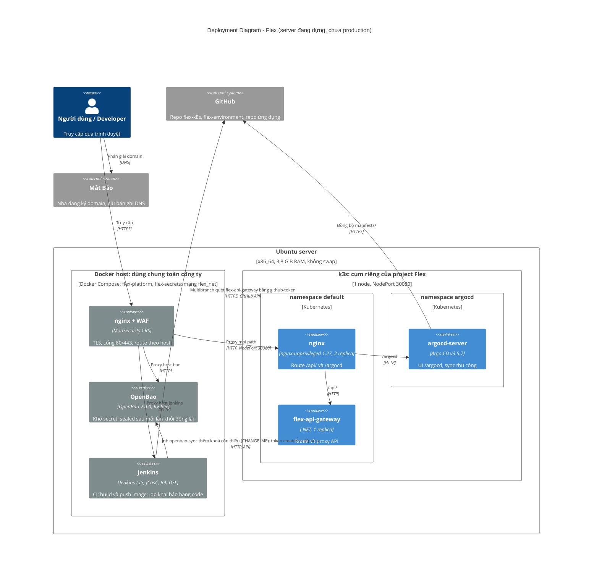

# C4 Deployment - Flex (server đang dựng)

Nguồn: `flex-environment/AGENTS.md`, `flex-environment/docker-compose.{nginx,tools,infra,openbao}.yml`, `flex-environment/mounts/jenkins/`, `flex-environment/mounts/nginx/sites/prod/`, `flex-k8s/README.md`, `flex-k8s/manifests/`, `flex-k8s/argocd/`, cùng xác nhận của người dùng về phân tách Docker dùng chung và k8s riêng từng project. Chỉ đọc cấu hình trong repo, chưa kiểm tra server thật (`kubectl`, `docker ps`), nên đây là topology khai báo, chưa phải trạng thái chạy.

**Chú giải màu**: xám = hạ tầng Docker dùng chung toàn công ty; xanh (mặc định) = thành phần riêng của project Flex chạy trong k3s. Ranh giới dùng chung / riêng Flex là cạnh nginx + WAF → nginx k3s qua NodePort `30080`.

## Ghi chú

| Thành phần | Thuộc về | Trạng thái | Bằng chứng |
| --- | --- | --- | --- |
| nginx Docker (WAF) → NodePort `30080` | Dùng chung (Docker) | `Confirmed` (khai báo) | `flex-k8s/README.md` mục "Cài Argo CD", `flex-environment/AGENTS.md` mục 3, 4 |
| Jenkins: host `jenkins.luyenhaidangit.pro` (không còn tiền tố `/jenkins`), secret đọc từ OpenBao, job tạo bởi Seed Job từ `mounts/jenkins/jobs/*.groovy` | Dùng chung (Docker) | `Confirmed by user` | `docker-compose.infra.yml`, `mounts/jenkins/jenkins.yaml`, `mounts/jenkins/seeds/seed.groovy`; người dùng đã chạy thành công Seed Job (build #2) và thấy folder `misa` |
| Jenkins GitHub: plugin `github`, `github-branch-source`; credential `github-token` (khoá `github_username`, `github_token` trong secret `flex/github`); `misa/flex-api-gateway` khai báo Multibranch, chỉ nhận nhánh `main`, không build PR | Dùng chung (Docker) | `Declared` (chưa chạy thử) | `plugins/plugins.txt`, `jenkins.yaml`, `jobs/misa.groovy`, `mounts/openbao/secrets.list`; chưa build lại image, chưa chạy Seed Job với cấu hình này |
| Jenkins job `infra/openbao-sync`: chạy tay (Build with Parameters), checkout `main` rồi gọi API OpenBao để thêm khoá khai báo trong `secrets.list` còn thiếu vào secret đã có (value `CHANGE_ME`, không ghi đè value đã có); token OpenBao nhập qua tham số `BAO_TOKEN` mỗi lần chạy (không lưu trong Jenkins), policy cần `create`/`read`/`patch` trên `flex/data/*` (đọc được mọi secret) | Dùng chung (Docker) | `Declared` (script đã chạy thử với server giả, chưa chạy trên Jenkins và OpenBao thật) | `mounts/jenkins/jobs/infra.groovy`, `jenkins/openbao-sync.Jenkinsfile`, `jenkins/openbao-sync.sh`, `mounts/openbao/secrets.list`; OpenBao sealed thì job lỗi |
| OpenBao (thay Infisical): project compose `flex-secrets` riêng, UI qua host `bao.luyenhaidangit.pro`, cổng `127.0.0.1:8200` | Dùng chung (Docker) | `Confirmed` (khai báo) | `docker-compose.openbao.yml`, `mounts/nginx/sites/prod/bao.luyenhaidangit.pro.conf`; sealed sau mỗi lần container khởi động lại, phải unseal tay |
| Mắt Bão (DNS) | Ngoài hệ thống | `Confirmed` (khai báo) | `setup/02-init-nginx.sh` hỏi đã thêm bản ghi DNS ở Mắt Bão trước khi cấp chứng chỉ |
| nginx k8s: 2 replica, `/api/` → gateway, `/argocd` → Argo CD | Riêng Flex (k3s) | `Confirmed` (khai báo) | `manifests/nginx/{deployment,configmap}.yaml` |
| `flex-api-gateway`: 1 replica, image `1.0.1-dev`, chỉ nginx được vào cổng 8080 | Riêng Flex (k3s) | `Confirmed` (khai báo) | `manifests/flex-api-gateway/{deployment,networkpolicy}.yaml` |
| Argo CD v3.5.7, non-HA, application `flex` sync thủ công | Riêng Flex (k3s) | `Confirmed` (khai báo) | `argocd/install/`, `argocd/application.yaml` |
| Portainer, netshoot | Dùng chung (Docker), không vẽ cạnh | Không vẽ | Portainer chỉ nghe `127.0.0.1:9000` trên server (SSH tunnel), có host riêng ở site prod |

## Cập nhật Jenkins

Cập nhật chính Jenkins là thao tác thủ công, không có job tự build lại Jenkins trong Jenkins (người dùng đã chọn giữ như vậy). `plugins.txt` pin version 10 plugin chính; plugin phụ thuộc không pin (quyết định của người dùng).

| Sửa | Cách áp dụng | Bằng chứng |
| --- | --- | --- |
| `mounts/jenkins/Dockerfile`, `plugins/plugins.txt`, `JENKINS_VERSION` | Chạy tay `bash publish-jenkins.sh` (build, push Docker Hub, recreate container); sao lưu volume `jenkins_data` trước khi chạy trên production | `publish-jenkins.sh`, `flex-environment/AGENTS.md` mục "Boundaries" |
| `mounts/jenkins/jenkins.yaml` | Không build lại: reload JCasC hoặc restart container `jenkins` | `docker-compose.infra.yml` (mount `:ro`) |
| `mounts/jenkins/seeds/`, `mounts/jenkins/jobs/*.groovy` | Không build lại: Seed Job tự poll `main` mỗi ~5 phút | `seeds/seed.groovy` |

## Chưa vẽ / cần xác minh

- **Trạng thái chạy thật**: README `flex-k8s` còn ghi "chưa apply lên cluster nào" nhưng cũng mô tả Argo CD đang truy cập qua `flex.luyenhaidangit.pro/argocd`. Cần `kubectl get pods -A` và `docker ps` trên server để chốt.
- **Phân tách dùng chung / riêng**: "Docker dùng chung toàn công ty" là xác nhận của người dùng. Trong repo, stack Docker vẫn mang tên Flex (`flex-platform`, `flex_net`, host `luyenhaidangit.pro`), và chưa thấy project khác đi qua nginx WAF, nên chưa vẽ project khác.
- **`flex-auth-service` chưa có trong cluster**: README `flex-k8s` ghi route `/api/*` trả 502/503 cho tới khi triển khai.
- **Frontend**: chưa thấy workload frontend trong `flex-k8s`; nginx k8s chỉ route `/api/` và `/argocd`. Chưa rõ frontend chạy ở đâu.
- **Cảnh báo bảo mật còn mở** (theo README): NodePort `30080` cần firewall host chặn Internet; `/argocd` đang cho mọi IP, chỉ có đăng nhập admin bảo vệ.
- **Stack dev cũ** (PostgreSQL, MySQL, Redis, RabbitMQ, MinIO, Elasticsearch, Ollama, Prometheus, Grafana) nằm ở `flex-environment/temp/`; `app` và `monitoring` hiện là `services: {}`, còn `infra` chỉ có Jenkins; phần còn lại chờ migrate nên chưa vẽ.
- Địa chỉ IP, cổng SSH và domain nội bộ không ghi vào tài liệu này.
