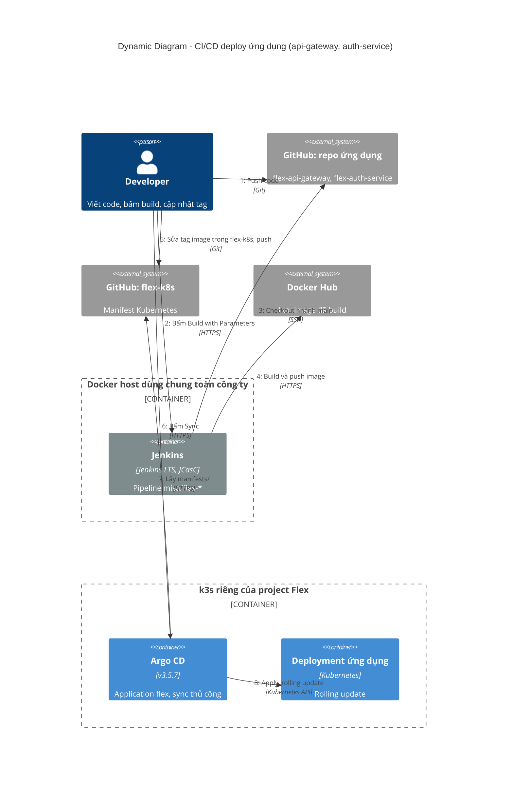

# C4 Dynamic - Luồng CI/CD deploy ứng dụng

Áp dụng cho `flex-api-gateway` và `flex-auth-service` (hai repo có `Jenkinsfile` giống nhau). Nguồn: `flex-api-gateway/Jenkinsfile`, `flex-auth-service/Jenkinsfile`, `flex-environment/mounts/jenkins/jobs/flex.groovy`, `flex-k8s/README.md`, `flex-k8s/restart.sh`, `flex-k8s/argocd/application.yaml`, cùng xác nhận của người dùng về vị trí Jenkins. Chỉ đọc cấu hình trong repo, chưa chạy thử pipeline.

**Chú giải màu**: xám = hạ tầng Docker dùng chung toàn công ty; xanh (mặc định) = thành phần riêng của project Flex trong k3s.

## Các bước

| Bước | Hành động | Thuộc về | Tự động? | Bằng chứng |
| --- | --- | --- | --- | --- |
| 1 | Push code lên GitHub | Repo ứng dụng | Thủ công | Jenkins job lấy nhánh `main` |
| 2 | Chạy build với tham số `TARGET_ENV` (dev/uat/prod), `MAJOR`, `MINOR`, `PROD_PATCH`, `DEPLOY` | Docker dùng chung (Jenkins) | Thủ công | `Jenkinsfile` không có `triggers`, `flex.groovy` không có webhook hay polling |
| 3 | Checkout, tính `VERSION` | Docker dùng chung (Jenkins) | Tự động | stage `Checkout`, `Prepare` |
| 4 | `docker build` rồi tag và push `<user>/<app>:<VERSION>` lên Docker Hub (chỉ khi `DEPLOY=true`) | Docker dùng chung (Jenkins) | Tự động | stage `Image`, `Publish`, credential `dockerhub-creds` |
| 5 | Sửa `image:` trong `flex-k8s/manifests/<app>/deployment.yaml` rồi push | Repo `flex-k8s` | **Thủ công** | README `flex-k8s` mục "Cập nhật nhanh" |
| 6 đến 8 | Argo CD sync `manifests/` vào namespace `default` | k3s riêng Flex | Thủ công | `syncPolicy: {}` trong `argocd/application.yaml` |

Ranh giới dùng chung / riêng nằm giữa bước 4 và bước 5: Jenkins (dùng chung) chỉ đẩy image lên Docker Hub; từ đó trở đi là phần riêng của Flex (repo `flex-k8s`, Argo CD, k3s), và hai bên không gọi trực tiếp nhau.

Quy tắc version: môi trường không phải prod dùng `MAJOR.MINOR.<BUILD_NUMBER>-<env>` (ví dụ `1.0.12-dev`); prod dùng `MAJOR.MINOR.PROD_PATCH` và bắt buộc có `PROD_PATCH`.

Cách deploy thay thế bước 6 đến 8: chạy `bash restart.sh [app]` trong `flex-k8s` trên server. Script `kubectl apply`, restart deployment nếu ConfigMap đổi, chờ `rollout status` 180 giây; lỗi thì in log và gợi ý `kubectl rollout undo deployment/<tên>` (không tự rollback).

## Điểm cần lưu ý

- **Chưa liền mạch**: sau khi build xong image, không có bước nào tự cập nhật tag trong `flex-k8s` (bước 5) và Argo CD không tự sync. Mỗi lần deploy cần hai thao tác tay.
- **Stage Build, Test, Quality & Security chỉ in "Nothing to do"** trong cả hai Jenkinsfile, nên pipeline hiện chưa có kiểm tra chất lượng nào trước khi push image.
- **Vị trí Jenkins**: đặt ở Docker host dùng chung theo xác nhận của người dùng. Trong repo, cấu hình Jenkins nằm ở `flex-environment/temp/` và file `infra` trên server hiện rỗng, nên chưa kiểm chứng được qua repo.
- **Chưa xác minh**: pipeline `flex-ai-gateway` (khai báo trong `flex.groovy` nhưng repo này không có trong `workstation.json`).
- **`flex-exchange-service`** có `.github/workflows/ci.yml` riêng, mình chưa đọc nên không vẽ.

## Luồng khác: GitHub Actions cho `flex-environment` (không vẽ)

`flex-environment/.github/workflows/ci-cd.yml` chạy khi push hoặc **pull request** vào `main` (và thủ công): SSH vào server rồi chạy `./restart.sh`. Theo `flex-environment/AGENTS.md`, `restart.sh` không có terminal sẽ chạy `all`, tức là `git pull`, `down` rồi `up -d` toàn bộ container. Trigger `pull_request` nghĩa là PR cũng có thể kích hoạt deploy, cần xem lại.
