# Speckit Workflow

Luồng làm việc chuẩn với bộ Speckit cho `flex-workstation`.

Ghi chú cú pháp: Codex gọi skill bằng `$speckit-*`; Antigravity IDE/CLI và Claude Code gọi bằng `/speckit-*`. Cả ba runtime dùng chung source `.agents/skills/`. `speckit-specify` cho phép model tự kích hoạt khi người dùng mô tả feature tự nhiên; 10 skill `speckit-*` còn lại đặt `disable-model-invocation: true` để bảo vệ gate người dùng chủ động gọi tường minh từng phase.

## Phân loại Track (trước bước 1)

- **Light Track** — bug nhỏ đã có test, hoặc refactor không đổi hành vi: làm trực tiếp kèm test, không cần Speckit. Nếu phát hiện phải đổi hành vi nghiệp vụ, dừng và chuyển sang Spec Track.
- **Compact Spec Track** — feature nhỏ–vừa nằm gọn trong 1 repo, không đổi DB schema dùng chung, không tạo breaking public contract: đi Speckit với `Chế độ Spec: Compact` (nhúng thẳng research, entity và quickstart ngay trong `plan.md`, tránh đẻ thêm các file rời `research.md`, `data-model.md`, `quickstart.md` không cần thiết).
- **Full Spec Track** — feature lớn, chạm nhiều repo, có DB migration hoặc thay đổi domain/contract quan trọng: đi Speckit đầy đủ kèm trọn bộ artifact Phase 0/1.
- Chưa rõ thuộc track nào thì hỏi người dùng.

## Sơ đồ luồng

```mermaid
flowchart TD
    START(["Bắt đầu"])

    subgraph SETUP ["⚙️  Setup — chạy một lần cho project"]
        constitution["$speckit-constitution hoặc /speckit-constitution\nThiết lập nguyên tắc dự án"]
    end

    subgraph FEATURE ["🔁  Mỗi feature (Compact hoặc Full)"]
        specify["$speckit-specify hoặc /speckit-specify\n&lt;mô tả nghiệp vụ — chỉ WHAT + WHY&gt;\nGắn Chế độ Spec: Compact | Full"]
        clarify_gate{Còn mơ hồ?}
        clarify["$speckit-clarify hoặc /speckit-clarify\nTối đa 5 câu làm rõ spec"]
        docbiz["$speckit-docbiz hoặc /speckit-docbiz\nDocumentation Impact Gate bắt buộc"]
        checklist_gate{Cần checklist\ndomain?}
        checklist["$speckit-checklist domain\nChecklist ux / security / api"]
        plan["$speckit-plan hoặc /speckit-plan\nTạo repos.md + thiết kế kỹ thuật\nCompact: inline | Full: Phase 0/1 files"]
        tasks["$speckit-tasks hoặc /speckit-tasks\nSinh tasks.md + static validation"]
        issues_gate{Dùng\nGitHub Issues?}
        taskstoissues["$speckit-taskstoissues\nChuyển tasks → GitHub Issues"]
        analyze_gate{Cần quality\ngate?}
        analyze["$speckit-analyze\nCross-artifact consistency check"]
        implement["$speckit-implement\nThực thi tasks (Trạng thái: Đang triển khai)"]
        converge["$speckit-converge\nKiểm tra gap code ↔ spec/plan/tasks"]
        gap_check{Còn gap hoặc\nvi phạm specialist skill?}
        closeout["Closeout trong speckit-converge\n1. Final Specialist Review (flex-using-agent-skills)\n2. Spec Reconciliation (Ngày reconcile cuối)\n3. Chốt Trạng thái: Hoàn thành"]
        done(["✅ Feature hoàn thành & sẵn sàng PR"])
    end

    START --> constitution --> specify --> clarify_gate
    clarify_gate -->|Có| clarify --> docbiz
    clarify_gate -->|Không| docbiz
    docbiz --> checklist_gate
    checklist_gate -->|Có| checklist --> plan
    checklist_gate -->|Không| plan
    plan --> tasks --> issues_gate
    issues_gate -->|Có| taskstoissues --> analyze_gate
    issues_gate -->|Không| analyze_gate
    analyze_gate -->|Có| analyze --> implement
    analyze_gate -->|Không| implement
    implement --> converge --> gap_check
    gap_check -->|Có — append tasks.md| implement
    gap_check -->|Không — 0 gap| closeout --> done
```



## Bảng commands

| # | Command | Loại | Input | Output |
|---|---------|------|-------|--------|
| 0 | `$speckit-constitution` / `/speckit-constitution` | Core · Setup | Nguyên tắc dự án | `.specify/memory/constitution.md` |
| 1 | `$speckit-specify` / `/speckit-specify` | Core | Mô tả nghiệp vụ (WHAT + WHY) | `specs/<id>/spec.md` (`Compact`/`Full`), `checklists/requirements.md` |
| 2 | `$speckit-clarify` / `/speckit-clarify` | **Optional** | — | `spec.md` cập nhật (tối đa 5 câu hỏi) |
| 2a | `$speckit-docbiz` / `/speckit-docbiz` | **Core · Documentation Impact Gate** (trước `plan`) | `spec.md` và `docs/` | Cập nhật `spec.md` §20; sửa có chọn lọc doc hiện hữu chỉ khi tác động đáng kể |
| 3 | `$speckit-checklist [domain]` / `/speckit-checklist [domain]` | **Optional** | `ux` / `security` / `api` | `checklists/<domain>.md` |
| 4 | `$speckit-plan` / `/speckit-plan` | Core | Tech stack + architecture | `repos.md` (nếu chạm sub-repo), `plan.md` (+ `research.md`, `data-model.md`, `contracts/`, `quickstart.md` ở chế độ `Full`) |
| 5 | `$speckit-tasks` / `/speckit-tasks` | Core | — | `tasks.md` (đã qua kiểm tra tĩnh) |
| 6 | `$speckit-taskstoissues` / `/speckit-taskstoissues` | **Optional** | — | GitHub Issues từ `tasks.md` |
| 7 | `$speckit-analyze` / `/speckit-analyze` | **Optional** | — | Báo cáo cross-artifact read-only (ưu tiên `research` subagent) |
| 8 | `$speckit-implement` / `/speckit-implement` | Core | — | Code, mark tasks `[X]`, `spec.md` `Trạng thái: Đang triển khai` |
| 9 | `$speckit-converge` / `/speckit-converge` | Core · Convergence & Closeout | — | Còn gap → append `tasks.md`; 0 gap → Final Specialist Review + Spec Reconciliation (`Ngày reconcile cuối`) + `Trạng thái: Hoàn thành` |

## Ghi chú vận hành quan trọng

### CLI đa nền tảng & làm việc song song nhiều feature (`scripts/speckit-cli.js`)
Thứ tự ưu tiên xác định thư mục feature trên cả Windows lẫn Linux Cloud container:
1. Tham số trực tiếp trong lệnh/CLI: `--feature <id-hoặc-slug>` (ví dụ `/speckit-plan 000042` hoặc `node scripts/speckit-cli.js setup-plan --feature 42 --json`).
2. Biến môi trường `SPECIFY_FEATURE_DIRECTORY` (chỉ có hiệu lực trong phiên shell đó, **không ghi đè** vào `.specify/feature.json`).
3. `.specify/feature.local.json` (đã gitignore — dùng `--pin` để ghim cục bộ cho máy cá nhân mà không làm bẩn `git status`).
4. `.specify/feature.json` (fallback chung của Spec Kit).

Các lệnh kiểm tra tĩnh tự động (chạy <50ms, thay thế việc LLM đếm checkbox/placeholder bằng mắt):
```bash
node scripts/speckit-cli.js validate --feature <id> --stage specify|plan|tasks|implement|converge [--verify-closed]
```

### Tránh tạo trùng `short-name` khi chạy lại `/speckit-specify`
- `/speckit-specify` dùng `node scripts/speckit-cli.js setup-specify --short-name <slug> --mode <Compact|Full> --json` (đa nền tảng Windows/Linux): tự dò trùng `specs/*-<short-name>` trước khi tạo thư mục hoặc chạy `HOOKS.before`, rồi hỏi người dùng chọn **cập nhật spec hiện có** hoặc **tạo feature mới**.
- Khi cập nhật spec hiện có (`--feature <selected>`), `checklists/requirements.md` được giữ nguyên lịch sử review/ngoại lệ và chỉ đánh giá lại các mục `CHK###`; đồng thời cả `.specify/feature.local.json` và `.specify/feature.json` đều được đồng bộ.

### Documentation Impact Gate (`speckit-docbiz`) & Repo Scope Gate (`repos.md`)
- Sau lần sửa cuối của `spec.md` và trước `speckit-plan`, bắt buộc chạy `speckit-docbiz` để điền `spec.md` §20 (`setup-plan` sẽ chặn tự động nếu §20 còn `CHƯA ĐÁNH GIÁ` hoặc `CẦN ĐÁNH GIÁ LẠI`).
- Khi `/speckit-specify` (chế độ cập nhật) hoặc `/speckit-clarify` sửa các mục nghiệp vụ trọng yếu (`§3`, `§5`, `§7`, `§8`, `§9`, `§15`) trên spec đã từng đánh giá §20, agent đặt lại `§20 **Trạng thái**` thành `CẦN ĐÁNH GIÁ LẠI` để tránh gate bị stale.
- `/speckit-clarify` ưu tiên gom tối đa 3–5 câu hỏi độc lập vào một lượt interactive picker (khi runtime hỗ trợ) và ghi `spec.md` theo batch; chỉ hỏi tuần tự 1 câu/lượt khi câu sau phụ thuộc câu trước hoặc runtime không có picker.
- Ngay đầu `/speckit-plan`, nếu feature chạm bất kỳ sub-repo nào trong `workstation.json` mà chưa có `specs/<id>/repos.md`, agent bắt buộc chạy `flex-repo-scope` để khởi tạo `repos.md` (`Edit`/`Read`/`Skip`).

### Quality Gates & Khử thiên kiến tự chấm (Self-Grading Bias)
- `checklists/requirements.md` sinh từ template mặc định ở trạng thái `- [ ] ... [Status: Chưa kiểm]` để buộc đánh giá từng tiêu chí `CHK001–CHK016`. Quy ước checkbox: `Pass`, `Không áp dụng` và `Fail (ngoại lệ đã phê duyệt)` dùng `[x]`; `Fail` chưa duyệt hoặc `Chưa kiểm` dùng `[ ]` và chặn `/speckit-implement`.
- Với `/speckit-analyze` và `/speckit-converge`, khi chạy nối tiếp trong cùng phiên vừa viết plan/code, ưu tiên ủy quyền bước dò lỗi cho subagent đọc độc lập (`research`) để tăng tính khách quan.

### Đóng vòng đời tại `/speckit-converge` (Convergence & Closeout)
- **Khi còn gap hoặc vi phạm chuẩn kỹ thuật (`tasks_appended`)**: chỉ append `## Phase N: Convergence` vào cuối `tasks.md`, giữ `Trạng thái: Đang triển khai` để quay lại `/speckit-implement`.
- **Khi 0 gap (`converged`)**:
  1. Route các artifact đã sửa qua `flex-using-agent-skills` để kiểm tra checklist của các specialist skill tương ứng (`flex-dotnet-engineering`, `flex-database-engineering`, `flex-frontend-engineering`, `flex-naming-convention`, `flex-codebase-architect`...). Nếu phát hiện lỗi Blocker/High thì chuyển thành task append vào `tasks.md`.
  2. Thực hiện **Spec Reconciliation**: đối chiếu hành vi thực tế với `spec.md`, cập nhật `spec.md` nếu có điều chỉnh nhỏ trong phạm vi duyệt (nhắc chạy lại `speckit-docbiz` nếu đổi nghiệp vụ trọng yếu), ghi `**Ngày reconcile cuối**: YYYY-MM-DD — không đổi | đã cập nhật` và chuyển `**Trạng thái**: Hoàn thành`.
  3. Chạy `node scripts/speckit-cli.js validate --stage converge --verify-closed` để xác nhận khép kín.

## Artifacts sinh ra theo từng feature

```text
specs/
└── 000001-ten-feature/
    ├── spec.md              ← /speckit-specify (Compact | Full)
    ├── repos.md             ← /speckit-plan qua flex-repo-scope (khi chạm repo con)
    ├── plan.md              ← /speckit-plan (Compact nhúng thẳng research/data/quickstart)
    ├── research.md          ← /speckit-plan (chế độ Full — phase 0)
    ├── data-model.md        ← /speckit-plan (chế độ Full — phase 1)
    ├── quickstart.md        ← /speckit-plan (chế độ Full — phase 1)
    ├── contracts/           ← /speckit-plan (chế độ Full / khi có contract riêng)
    ├── tasks.md             ← /speckit-tasks (+ /speckit-converge appends)
    └── checklists/
        ├── requirements.md  ← /speckit-specify (bắt buộc)
        └── <domain>.md      ← /speckit-checklist [ux|security|api]

.specify/
├── feature.local.json       ← Con trỏ feature cục bộ (gitignored)
├── feature.json             ← Con trỏ mặc định Spec Kit
└── memory/
    └── constitution.md      ← /speckit-constitution
```
